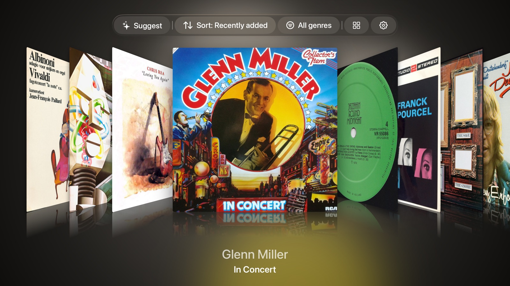

# Vinyl for Apple TV

Vinyl for Apple TV shows your Discogs record collection on an Apple TV. It plays no music: it is something to look at while a record plays on your turntable.



You sign in by scanning a QR code on the TV with your phone, then typing the code Discogs gives you into the TV. The app reads the vinyl in your collection and never changes anything on Discogs. Browse the covers as a carousel or a mosaic, sort them or filter them by genre, or let **Suggest** pick a record. Open a record to see its tracklist one side at a time, with credits. Swipe up and the cover stands on its own, ringed by a halo in its colours; the screensaver stays off while the halo shows.

[Website](https://andreisudarikov19.github.io/vinyl-art-apple-tv/) · [Guide](https://andreisudarikov19.github.io/vinyl-art-apple-tv/guide.html) · [Support](https://andreisudarikov19.github.io/vinyl-art-apple-tv/support.html) · [Privacy](https://andreisudarikov19.github.io/vinyl-art-apple-tv/privacy.html)

The app is not on the App Store yet.

## Requirements

- An Apple TV with tvOS 18 or later.
- A Discogs account. The app shows the releases in your collection whose format is Vinyl.

## Development setup

You need Xcode 26 or later and [XcodeGen](https://github.com/yonaskolb/XcodeGen) (`brew install xcodegen`).

1. Register an application at https://www.discogs.com/settings/developers
   (use **Create an Application**, not the personal-access-token button) to
   get a Consumer Key and Consumer Secret.
2. Copy the secrets template and fill in your credentials:
   ```sh
   cp Sources/Auth/AppSecrets.example.swift Sources/Auth/AppSecrets.swift
   # edit AppSecrets.swift with your Consumer Key and Secret
   ```
   `AppSecrets.swift` is gitignored, so your credentials stay local.
3. Generate the Xcode project and open it:
   ```sh
   xcodegen generate
   open VinylForAppleTV.xcodeproj
   ```
   The project is generated from `project.yml` and isn't committed. Run
   `xcodegen generate` again after editing `project.yml` or adding files.

## Running the tests

```sh
xcodegen generate
xcodebuild test -scheme VinylForAppleTV -destination 'platform=tvOS Simulator,name=Apple TV'
```

Any tvOS simulator will do; `xcrun simctl list devices tvOS` lists the ones you have.

The tests need no real Discogs keys. `AppSecrets.swift` has to exist for the project to build, but the template's placeholders are enough: copy it as in step 2 and leave them in. Every request in the tests goes to a stub, so they make no network calls.

CI ([`.github/workflows/ci.yml`](.github/workflows/ci.yml)) builds the app and runs the same tests on every pull request and every push to `main`. The tests run one at a time, because several suites share one stub.

## Versioning

The version and build number are set in `project.yml`, as `MARKETING_VERSION` and `CURRENT_PROJECT_VERSION`. When they change:

- a new feature or a visible change to how the app looks or behaves raises MINOR, for example 0.17.1 to 0.18.0;
- a fix raises PATCH, for example 0.18.0 to 0.18.1;
- the build number is the number of pull requests merged so far.

Run `xcodegen generate` after editing them.

## Third-party services

The app talks to three services and has no server of its own.

- [Discogs](https://www.discogs.com), through the [Discogs API](https://www.discogs.com/developers/): sign-in, your collection, each record's tracklist and credits, and the cover shown when the Cover Art Archive has none.
- [MusicBrainz](https://musicbrainz.org), through the [MusicBrainz API](https://musicbrainz.org/doc/MusicBrainz_API): matching each record to a MusicBrainz release.
- [Cover Art Archive](https://coverartarchive.org): the front cover of the matched release, or of its release group, shown in place of the Discogs image.

The [Discogs API Terms of Use](https://support.discogs.com/hc/en-us/articles/360009334593-API-Terms-of-Use) require this notice:

> This application uses Discogs’ API but is not affiliated with, sponsored or endorsed by Discogs. ‘Discogs’ is a trademark of Zink Media, LLC.

## Licence

The code is licensed under the [Apache License 2.0](LICENSE). Redistributions must keep the attribution notices in [NOTICE](NOTICE), as section 4(d) of the licence requires.

The licence covers the code in this repository. The data and cover images the app shows come from the services above under their own terms, and the covers belong to their copyright owners.
